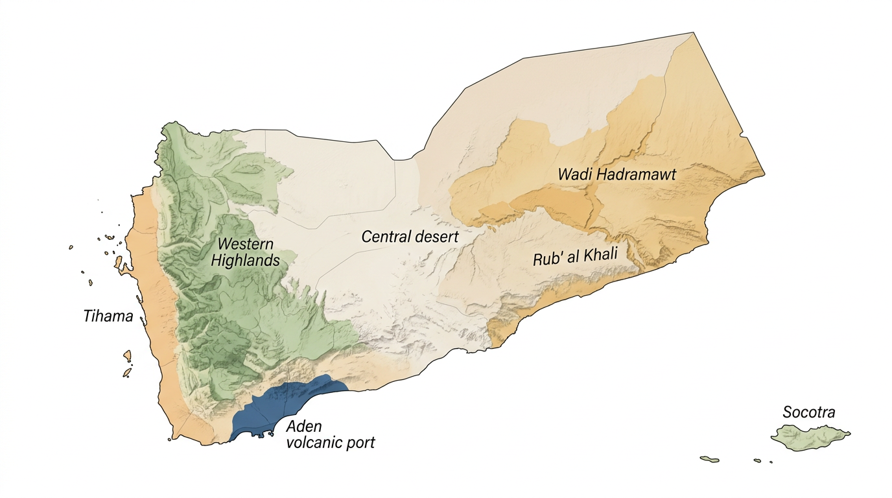
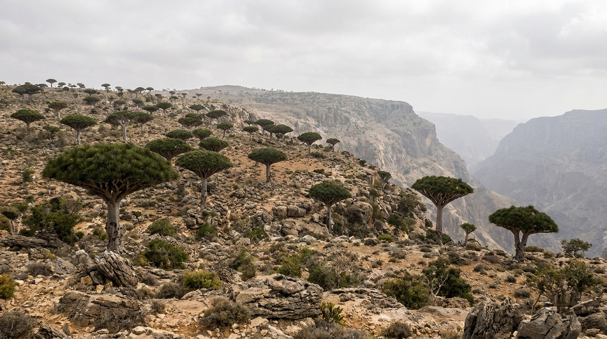
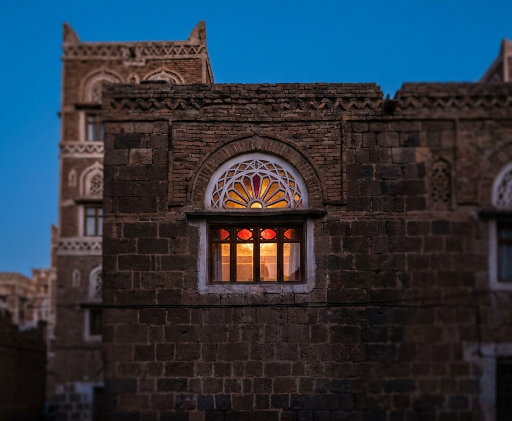
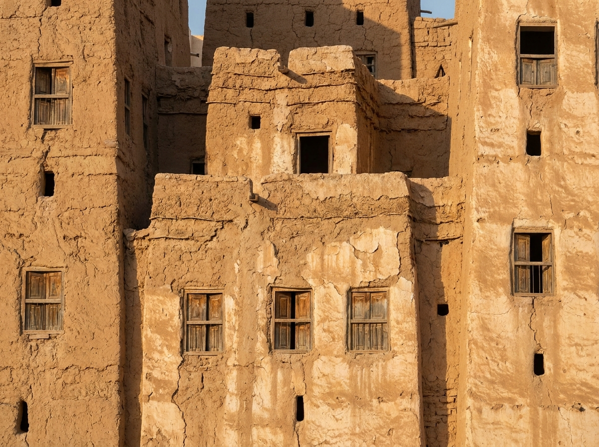
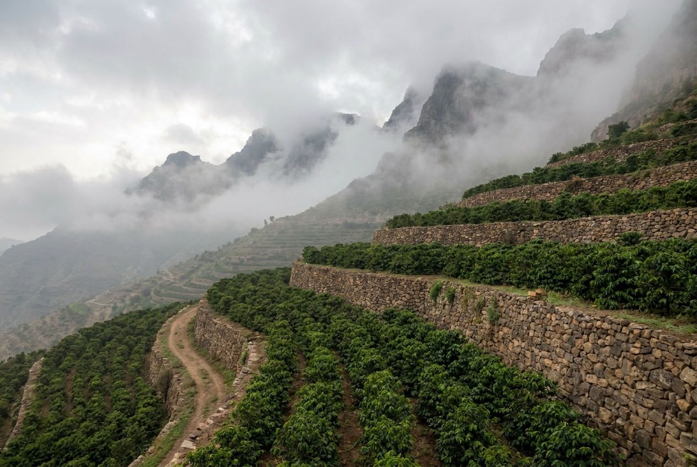
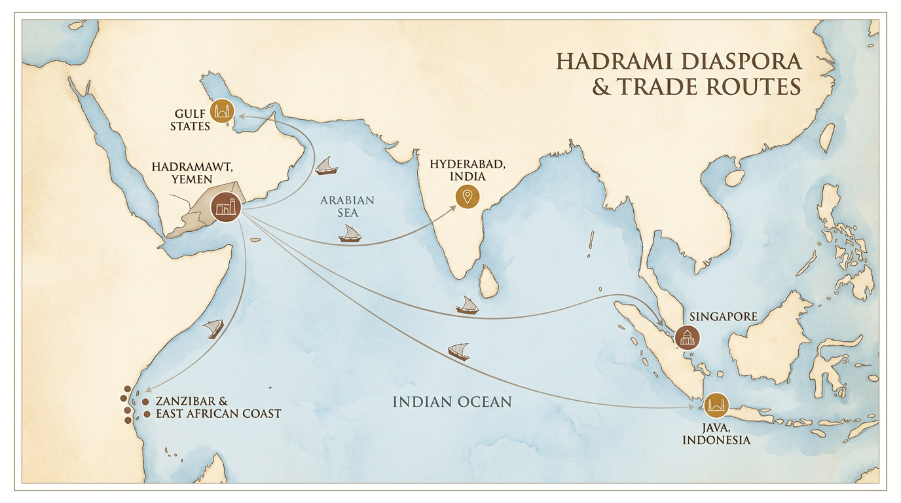

<!--
MARKUP KEY (full style map in YEMEN-DESIGN-SYSTEM.md §7)
# Part opener | ## Chapter title | ### Section heading
::: kicker | ::: deck | ::: pullquote | ::: takeaways | ::: glance | ::: myth
::: note | ::: figure | ::: art-slot | ::: timeline | ::: glossary | ::: cta
-->

::: titlepage
# YEMEN: BEYOND THE HEADLINES

::: subtitle
A Short Introduction to Its History, People, and Culture
:::

::: author
Moohialdin Al-Qudaimi
:::
:::

---

::: rights
© 2026 Moohialdin Al-Qudaimi. All rights reserved.

[Edition and ISBN lines to be added by the author at upload.]
:::

---

## A Note Before You Begin

::: note
This is a short book about a large country. It is built to be read in one sitting.

It is **not a travel guide**. Conditions in Yemen remain extremely dangerous, and no responsible book can tell you it is safe to visit. Chapter 11 explains where things stand.

What this book can do is introduce you to a country that is far more ancient, diverse, complex, and human than the image you probably carry.

Everything here reflects conditions as of **mid-2026**. Security, politics, and travel advisories change quickly. For anything time-sensitive, consult official government sources and UN agencies.
:::

---

## Contents

::: toc
**Start Here** — The Yemen You Think You Know
**Yemen at a Glance**
**Ten Things Most People Get Wrong**

**Part One · The Land**
1. A Vertical Country
2. The Island Evolution Forgot

**Part Two · The Deep Past and the Built World**
3. Older Than the Headlines
4. Cities That Shouldn't Exist

**Part Three · The People**
5. The People Behind the Word "Yemeni"
6. Tribe Is Not What You Think

**Part Four · Yemen and the World**
7. Coffee, Qat, and the Yemeni Table
8. Yemen Looks Outward
9. Aden: The Port That Collected the World

**Part Five · Today**
10. The Yemen of Today
11. If You're Tempted to Go

**The Country Behind the Headlines**

**Quick Reference** — Timeline · Glossary · Sources & Further Reading
:::

---

## Start Here

::: kicker
THE YEMEN YOU THINK YOU KNOW
:::

You already know a Yemeni word. You say it almost every day.

When you order a mocha at a café, you are naming a sleepy port on Yemen's Red Sea coast — al-Mokha — where, five centuries ago, the global coffee trade began. The beans were cultivated in Yemen's misty highlands by Sufi monks who discovered that a brew of roasted seeds could sustain prayer through the night. Within decades, coffeehouses spread from Aden to Cairo to Constantinople to London. Most of the world's Arabica coffee descends, in some sense, from a Yemeni mountain.

That is one fact about Yemen. Here is another: Yemen has been at war, intermittently, for more than a decade. Millions need humanitarian assistance. The economy has contracted by more than half. Entire neighborhoods of historic cities have been damaged or destroyed.

::: pullquote
Both facts are true. Neither is the whole story.
:::

Most people around the world, if they think about Yemen at all, see a country defined by conflict — a place that exists in headlines about airstrikes, humanitarian crises, and armed groups. Ask what Yemen looks like, and many would guess: desert, poverty, danger.

In reality, Yemen is one of the oldest continuously inhabited regions on Earth.

- Its capital, **Sana'a**, has been a living city for over 2,500 years.
- Its **mountain terraces** are among the most sophisticated agricultural landscapes ever built.
- Its port of **Aden** was a cosmopolitan crossroads centuries before the Suez Canal existed.
- Its **Hadramawt Valley** produced a global diaspora that reshaped societies from Indonesia to East Africa.
- Its island of **Socotra** harbors species found nowhere else on the planet, on a landmass that separated from Africa millions of years ago.

A short book cannot tell you everything about Yemen. But it can open a door that readers around the world never knew existed.

::: takeaways
### By the last page, you will be able to

- Place Yemen on the map and explain why it looks nothing like the desert you imagined.
- Name the ancient kingdoms, cities, and trade routes that made it a crossroads of the old world.
- Explain what "tribe" actually means in Yemen — and why the usual story gets it wrong.
- Trace the line from a Yemeni mountain terrace to your morning coffee.
- Describe the present conflict in a few clear sentences, without reducing Yemen to it.
:::

---

## Yemen at a Glance

::: glance
**Where** — The southwestern corner of the Arabian Peninsula; roughly the size of France.

**Borders** — Saudi Arabia to the north, Oman to the east, the Red Sea to the west, the Arabian Sea and Gulf of Aden to the south.

**Highest ground** — Western highlands above 3,000 meters, among the highest points on the peninsula.

**Capital** — Sana'a, at 2,200 meters above sea level; continuously inhabited for over 2,500 years.

**Great port** — Aden, wrapped around extinct volcanic craters.

**Island** — Socotra, 350 kilometers south of the mainland; UNESCO World Heritage Site since 2008.

**Languages** — Arabic, and Socotri, a Modern South Arabian language that is not a dialect of Arabic.

**Unified** — 1990, from the Yemen Arab Republic (north) and the People's Democratic Republic of Yemen (south).

**Gave the world** — Coffee, through the port of al-Mokha.

**UNESCO sites** — Old City of Sana'a · Old Walled City of Shibam · Historic Town of Zabid · Socotra Archipelago.
:::

---

## Ten Things Most People Get Wrong About Yemen

::: kicker
TEN MISCONCEPTIONS, BRIEFLY CORRECTED
:::

Skim these now. Each one is answered in full later in the book.

::: myth
**Myth: "Yemen is just desert."**

**Fact:** Yemen contains some of the highest mountains on the Arabian Peninsula, tropical coastal plains, agricultural terraces, deep wadis, and one of the world's most biodiverse islands. Desert exists, but it is far from the dominant landscape.

→ *Chapters 1 and 2*
:::

::: myth
**Myth: "All Yemenis are the same."**

**Fact:** Yemen contains dramatic regional variation in dialect, dress, food, architecture, social customs, and identity. A Tihami fisherman, a Sana'ani professional, a Hadrami merchant, and a Socotri herder occupy very different cultural worlds.

→ *Chapter 5*
:::

::: myth
**Myth: "Tribe means chaos."**

**Fact:** Tribal institutions have historically provided governance, dispute resolution, and social safety nets where the state could not. Tribal customary law is a structured, adaptable legal tradition, not the absence of order.

→ *Chapter 6*
:::

::: myth
**Myth: "The jambiya is a weapon."**

**Fact:** The curved dagger worn by many Yemeni men is primarily a marker of social identity, tribal affiliation, and regional origin. It is very rarely drawn or used as a weapon.

→ *Chapter 6*
:::

::: myth
**Myth: "Yemen has no history worth knowing."**

**Fact:** Yemen was home to some of the ancient world's most advanced civilizations, including the Kingdom of Saba. Its recorded history stretches back over three thousand years.

→ *Chapter 3*
:::

::: myth
**Myth: "Yemeni women have no public role."**

**Fact:** Women's roles vary enormously by region, class, and community. In rural areas, women are central to agricultural production. In Aden, a history of socialist-era reforms created different patterns of female participation. Generalizations fail across all of Yemen.

→ *Chapters 5 and 9*
:::

::: myth
**Myth: "Qat is like hard drugs."**

**Fact:** Qat is a mild stimulant, legally consumed throughout Yemen and parts of East Africa. Its social function is closer to a communal gathering than to substance abuse, though its economic and water-use costs are genuinely serious.

→ *Chapter 7*
:::

::: myth
**Myth: "Yemen is Sunni or Shia."**

**Fact:** Yemen's religious landscape is more complex than a simple binary. The northern highlands are home to Zaidis, a distinct branch of Shia Islam that is theologically closer to Sunni Islam than to the Twelver Shiism of Iran. Most of the south and east follows the Shafi'i school of Sunni Islam. Sufism also has deep roots, particularly in Hadramawt. For most of Yemen's history, sectarian identity was not the primary driver of politics.

→ *Chapter 10*
:::

::: myth
**Myth: "Nothing connects Yemen to the rest of the world."**

**Fact:** Yemen's historical trade networks, migration patterns, and cultural exchanges linked it to East Africa, India, Southeast Asia, and the Mediterranean for millennia. The Hadrami diaspora alone reshaped Muslim societies from Indonesia to Kenya.

→ *Chapters 7, 8, and 9*
:::

::: myth
**Myth: "The conflict is simple."**

**Fact:** Yemen's war involves multiple local, regional, and international actors with different and sometimes contradictory objectives. Any explanation that reduces it to two sides is misleading.

→ *Chapter 10*
:::

---

::: part
# PART ONE
## The Land
:::

::: art-slot
slot: A1 · Part One opener — see YEMEN-DESIGN-SYSTEM.md §10
:::

## Chapter 1 · A Vertical Country

::: kicker
THE GEOGRAPHY THAT EXPLAINS EVERYTHING
:::

::: deck
Yemen is not one landscape. It is six — and each one produced a different way of living.
:::

### Where Exactly Is Yemen?

Yemen occupies the southwestern corner of the Arabian Peninsula — roughly the size of France — wedged between Saudi Arabia to the north, Oman to the east, the Red Sea to the west, and the Arabian Sea and Gulf of Aden to the south. If you thought the Arabian Peninsula was nothing but flat, sandy desert, Yemen would quickly change your mind.

::: figure

*Yemen's geographic regions — from the lush Western Highlands to the desert interior and the island of Socotra.*
:::

### The Highlands

The western highlands rise to over 3,000 meters, making them among the highest points on the peninsula. These mountains catch monsoon moisture that the rest of Arabia never sees, creating terraced hillsides dense with agriculture — grains, fruit trees, coffee, and qat. Sana'a sits in a mountain valley at 2,200 meters above sea level. The air is cool, the light sharp, the sky enormous.

### The Tihama

Drop west from the highlands and you descend rapidly into the Tihama, a blistering coastal plain along the Red Sea. The Tihama is tropical, humid, and culturally distinct — its architecture is African-influenced, with round reed huts and brightly painted buildings. The port city of al-Hudaydah sits here, a lifeline for imports and humanitarian aid.

### The Interior and the Canyon

Travel east and the mountains gradually flatten into the vast interior — semi-arid plateaus and gravel deserts that merge into the Rub' al-Khali, the Empty Quarter. But cut into this landscape is one of Arabia's great natural wonders: **Wadi Hadramawt**, a canyon system running roughly 160 kilometers, whose valley floor supports dense date groves, towering mud-brick cities, and a culture so self-contained that Hadramis sometimes speak of Hadramawt as though it were a separate country.

### The Southern Coast

The southern coast faces the Arabian Sea and includes **Aden**, Yemen's great port city, wrapped around volcanic craters at the entrance to the Red Sea. Aden's geography is unlike anything else in Yemen — jagged peninsulas, extinct volcanoes, and a natural harbor that made it one of the busiest ports on the planet in the nineteenth century.

### And Then There Is Socotra

Lying 350 kilometers south of the mainland, closer to the Horn of Africa than to Sana'a, Socotra is a biological time capsule — an island separated from Africa for so long that a third of its plant species exist nowhere else on Earth. Its dragon's blood trees, with their dense mushroom-shaped canopies, have become among the most photographed trees in the world. We will visit it in the next chapter.

::: pullquote
It is a vertical country of mountains, a tropical coast, an interior desert, a canyon civilization, a volcanic port, and an island that evolution forgot.
:::

This is the first thing to understand about Yemen: it is not one landscape. And each of these geographies produced a different way of living.

::: takeaways
### In Brief

- Yemen is a country of mountains, coast, canyon, desert, port, and island — not a single sweep of sand.
- The western highlands catch monsoon moisture the rest of Arabia never sees, which is why terraced farming and coffee are possible.
- Geography is the key to Yemen's diversity: each region developed its own architecture, economy, and culture.
:::

---

## Chapter 2 · The Island Evolution Forgot

::: kicker
SOCOTRA — YEMEN, AND SOMETHING ELSE
:::

::: deck
Three hundred and fifty kilometers off the coast, a landscape that looks like another planet.
:::

### A Biological Time Capsule

Socotra breaks every assumption about what Yemen looks like. Lying 350 kilometers off the mainland, this archipelago of four islands is one of the most biologically distinctive places on Earth. Over a third of its plant species, 90 percent of its reptiles, and 95 percent of its land snails are found nowhere else. Its geological isolation — separated from the African mainland for at least six million years, and possibly twenty — has allowed species to evolve along paths entirely their own.

::: figure

*Dragon's blood trees on the plateau of Socotra — an island separated from Africa for millions of years.*
:::

### The Dragon's Blood Tree

The most famous resident is the dragon's blood tree (*Dracaena cinnabari*), with its dense, umbrella-shaped canopy and crimson-red resin. The resin — "dragon's blood" — has been traded since ancient times for use in medicine, dye, and varnish. Romans, Egyptians, and medieval Europeans all prized it. Today, these trees face growing threats from cyclones intensified by climate change, overgrazing by livestock, and a lack of young saplings reaching maturity.

### The People of Socotra

Socotra's human inhabitants — roughly 60,000 people — are largely pastoralists and fishermen. Many speak **Socotri**, a Modern South Arabian language that is not a dialect of Arabic but a separate language entirely, descended from the pre-Arabic languages of South Arabia. Socotri has no standard written form and is increasingly under pressure from Arabic, though efforts at documentation and preservation continue.

### Access and Politics

The island was inscribed as a UNESCO World Heritage Site in 2008. Tourism has been growing — approximately 5,000 visitors per year as of recent estimates — but access remains difficult. Flights have historically operated from Abu Dhabi on an irregular basis. The U.S. State Department, as of early 2026, warns specifically against travel to Socotra, noting that some tour companies outside Yemen sell trips with unofficial and invalid visas.

Politically, Socotra sits in a complicated space. The UAE has established a significant presence on the island, and its relationship to the Yemeni government on the mainland is contested. For the Socotri people themselves, the primary concerns are more immediate: livelihoods, access to services, the health of their ecosystem, and the survival of their language and way of life.

::: takeaways
### In Brief

- Socotra is home to species found nowhere else: over a third of its plants, 90 percent of its reptiles, 95 percent of its land snails.
- The dragon's blood tree is under pressure from cyclones, overgrazing, and too few young saplings.
- Socotri is a separate language, not a dialect of Arabic — and it is under pressure.
:::

---

::: part
# PART TWO
## The Deep Past and the Built World
:::

::: art-slot
slot: A2 · Part Two opener — see YEMEN-DESIGN-SYSTEM.md §10
:::

## Chapter 3 · Older Than the Headlines

::: kicker
THREE THOUSAND YEARS IN A FEW PAGES
:::

::: deck
Before Islam, before Christianity, South Arabia was already engineering dams and trading incense to the Mediterranean.
:::

### The Kingdom of Saba

Long before Islam, long before Christianity, the southwestern corner of Arabia was home to some of the ancient world's most sophisticated civilizations. The Kingdom of Saba — the biblical Sheba — built its capital at **Marib**, where an enormous dam held back seasonal floodwaters and irrigated thousands of hectares of farmland. This was engineering on a scale that rivaled anything in Mesopotamia or Egypt.

The Marib Dam sustained a civilization for more than a millennium. When it finally collapsed — tradition says around the sixth century CE — the event became one of the most powerful metaphors in Arabic literature and the Quran. Entire tribes dispersed across the peninsula. Many of the great Arabian lineages trace their origins to this scattering.

### Kingdoms of Incense

Saba was not alone. South Arabia held multiple kingdoms — Ma'in, Qataban, Hadramawt, Himyar — each with its own script, gods, trade networks, and monumental architecture. The region controlled the incense trade, exporting frankincense and myrrh along caravan routes that stretched to the Mediterranean. These were not primitive settlements. They were literate, commercially sophisticated, architecturally ambitious states.

### Islam and What Followed

When Islam arrived in the seventh century, Yemen was among the first regions to accept it. The Prophet Muhammad reportedly said of the Yemenis: "Faith is Yemeni, and wisdom is Yemeni." The Great Mosque of Sana'a, built during the Prophet's lifetime, is considered one of the oldest mosques in the world.

What followed was a long, often fractured political history — too complex to summarize here without turning these pages into a chronology lesson. The key points for a newcomer: Yemen was rarely unified under a single ruler. It was governed at various times by local imams, tribal confederations, foreign empires (the Ottomans held parts of Yemen twice), and eventually two separate modern states — the Yemen Arab Republic in the north and the People's Democratic Republic of Yemen in the south — before unification in 1990.

### The Deeper Point

::: pullquote
Yemen's civilization is not something that appeared recently or was borrowed from elsewhere. It grew from the land itself.
:::

It grew from monsoon rains, incense routes, mountain terraces, and a position at the crossroads of Africa, Asia, and the Indian Ocean.

::: takeaways
### In Brief

- Saba, Ma'in, Qataban, Hadramawt, and Himyar were literate, commercial, architecturally ambitious states.
- The Marib Dam sustained a civilization for over a thousand years; its collapse scattered tribes across Arabia.
- Yemen was rarely unified under one ruler until 1990.
:::

---

## Chapter 4 · Cities That Shouldn't Exist

::: kicker
ARCHITECTURE AS AUTOBIOGRAPHY
:::

::: deck
Tower houses of stone, brick, and mud — each region's answer to climate, trade, and status.
:::

### Sana'a: The City Lit from Within

Walk into the Old City of Sana'a and you enter a place that looks almost fictional. Tower houses rise six, seven, eight stories high, built of dark stone at the base and lighter brick above, decorated with white gypsum tracery around every window. At night, stained-glass fanlights — *qamariyyat*, literally "little moons" — glow from the upper floors. The effect is of a city illuminated from within.

::: figure

*A qamariyyah stained-glass fanlight glowing from within a tower house in old Sana'a at twilight.*
:::

These buildings are not museum pieces. Families live in them. The ground floors traditionally served as storage or animal quarters. Upper floors housed family rooms, kitchens, and the ***mafraj*** — a top-floor reception room with panoramic views, where guests are welcomed, qat is chewed, and conversations stretch into the afternoon. Sana'a's Old City, inscribed as a UNESCO World Heritage Site in 1986 and placed on the danger list in 2015, contains more than 6,000 of these structures — the largest intact example of this architectural tradition anywhere.

### Shibam: A Compact Manhattan of Mud

Now travel to the Hadramawt Valley and encounter a completely different architectural genius. Shibam, a walled town of around 500 mud-brick tower houses, rises from the valley floor like a compact Manhattan. The buildings reach up to eight stories, built entirely of sun-dried mud brick, and have stood for centuries. Shibam is often called "the oldest skyscraper city in the world," and while that phrase is journalistic shorthand, the reality is genuinely astonishing: a medieval urban vision of vertical living, constructed from earth.

::: figure

*Mud-brick tower houses in the Hadramawt Valley — a medieval vision of vertical living, built from earth.*
:::

### Tarim, al-Hudaydah, and Zabid

Nearby Tarim, at the eastern end of Wadi Hadramawt, reveals yet another aesthetic — whitewashed palaces and mansions in a style that mixes Yemeni traditions with influences brought home by merchants who made their fortunes in Southeast Asia. Tarim reportedly has more mosques per capita than any other city in Yemen.

On the Tihama coast, architecture shifts again — Ottoman-influenced merchant houses in al-Hudaydah, with wooden balconies and coral-stone walls. In Zabid, once one of the great Islamic university cities, geometric brick decoration reaches a level of refinement that reflects centuries of scholarly prestige.

### The Diversity Is the Point

::: pullquote
Yemen's architecture is not one style repeated across a country.
:::

It is a collection of local solutions — to climate, material, status, trade, religion, and social organization — that vary dramatically within a few hundred kilometers.

::: takeaways
### In Brief

- Sana'a: dark stone, lighter brick, white gypsum tracery, and glowing *qamariyyat* — families still live inside.
- Shibam: around 500 mud-brick towers, "the oldest skyscraper city in the world."
- Tarim, al-Hudaydah, and Zabid each show a different local answer to climate, trade, and scholarship.
:::

---

::: part
# PART THREE
## The People
:::

::: art-slot
slot: A3 · Part Three opener — see YEMEN-DESIGN-SYSTEM.md §10
:::

## Chapter 5 · The People Behind the Word "Yemeni"

::: kicker
FAMILY, HONOR, HOSPITALITY, AND THE PRIVACY YOU MUST RESPECT
:::

::: deck
Generous to the point of obligation — and private in ways outsiders must learn to read.
:::

### Hospitality — and Its Counterpart

A visitor arriving in Yemen — in whatever future that becomes possible — will almost certainly be struck first by hospitality. Offering food, coffee, and shelter to a guest is not a formality in most Yemeni communities. It is a deeply internalized social obligation. Refusing hospitality can cause genuine offense.

But hospitality has a counterpart that outsiders must understand: **privacy**. Yemeni social life distinguishes sharply between public and private space. The home — particularly the women's quarters — is a boundary that outsiders should not expect to cross casually. Asking direct questions about someone's wife or female family members is considered intrusive in many communities, particularly in the highlands and rural areas. This is not hostility. It is a social grammar that operates on different rules than Western informality.

### Family Comes First

Family is the fundamental social unit, and extended family networks shape everything from business to politics. In many parts of Yemen, a person's identity is defined not just by their name but by their family, their region, and — in tribal areas — their tribal affiliation. Introductions often include a chain of names and places that locate a person within a web of relationships.

### Not One Society

It is important to note that "Yemeni society" is not one society. An educated professional in Aden will have a very different daily life from a highland tribesman near Sa'dah, a fisherman in al-Mukalla, a Socotri herder on Socotra, or a merchant family in Taiz. Urban and rural, coastal and highland, northern and southern — these differences are real and deep.

### Yemeni Women: Handle Generalizations with Care

Common Western misunderstandings about Yemeni women deserve particular care. Women's roles, visibility, dress, education, and economic participation vary enormously by region, class, and community. In some areas, women manage significant economic activities, particularly in agriculture and small commerce, while maintaining limited public visibility.

::: pullquote
Generalizations about "Yemeni women" almost always describe only one slice of a highly varied reality.
:::

::: takeaways
### In Brief

- Hospitality is an obligation, not a courtesy; privacy — especially around women and the home — is its counterpart.
- Identity is anchored in family, region, and, in tribal areas, tribe.
- "Yemeni society" is many societies. Be suspicious of any sentence that begins "Yemenis are…"
:::

---

## Chapter 6 · Tribe Is Not What You Think

::: kicker
THE MOST MISUNDERSTOOD WORD IN ARABIAN POLITICS
:::

::: deck
Armed men and lawlessness? The reality is closer to a customary legal system.
:::

### What a Tribe Actually Is

When Western media mentions "tribes" in Yemen, the image that forms is usually negative — armed men, lawlessness, a breakdown of order. This is a fundamental misunderstanding of what tribe means in the Yemeni context.

A tribe (*qabilah*) in Yemen is, at its core, a social organization — a network of families and clans bound by shared territory, kinship (real or claimed), mutual obligations, and customary law. Tribal law (*'urf*) is not the absence of law. It is a sophisticated, adaptable legal tradition that governs property disputes, personal injury, water rights, territorial boundaries, and conflict resolution through mediation and arbitration. In many areas, tribal customary law resolves an estimated 80 percent of disputes — often more effectively than the formal judiciary.

### The Sheikh Is Not a Warlord

The tribal sheikh is, in principle, a mediator — someone whose authority rests on his ability to resolve conflicts, build consensus, and represent his community. His position requires persuasion, not coercion. The anthropologist Steven Caton, who spent years among Yemeni tribes, emphasized this distinction: tribal power in its traditional form is about discussion and engagement, not domination.

### Settled, Not Nomadic

Tribesmen make up an estimated 70–80 percent of Yemeni society. They are mostly settled farmers and herders, not nomads. They live in villages and towns with defined territories. Their customary law includes detailed provisions for protecting travelers, markets, water sources, and public spaces. The concept of ***hijrah*** — a protected zone, often around a religious or scholarly community — is a tribal institution that ensures certain places and people are exempt from conflict.

### Not Idyllic — but Not Chaos

None of this means tribal society is idyllic. Armed conflict between tribes occurs. The proliferation of weapons is real. The modern conflict has distorted traditional structures, with tribal leaders sometimes co-opted by warring parties.

::: pullquote
Tribal institutions have, for centuries, provided the social infrastructure that the central state could not.
:::

Equating "tribal" with "chaotic" or "primitive" misses that fundamental reality.

### The Jambiya: A Tie, Not a Threat

The *jambiya* — the curved dagger worn by many Yemeni men — is often photographed as evidence of a "warrior culture." In practice, the jambiya is primarily a social marker. It identifies tribal affiliation, social status, and regional origin. Wearing it is more akin to wearing a school tie or a family crest than carrying a weapon. The blade is rarely drawn.

::: takeaways
### In Brief

- A tribe (*qabilah*) is a social organization; customary law (*'urf*) resolves an estimated 80 percent of disputes in many areas.
- The sheikh is, in principle, a mediator who governs by persuasion.
- The jambiya signals identity — like a school tie or a family crest.
:::

---

::: part
# PART FOUR
## Yemen and the World
:::

::: art-slot
slot: A4 · Part Four opener — see YEMEN-DESIGN-SYSTEM.md §10
:::

## Chapter 7 · Coffee, Qat, and the Yemeni Table

::: kicker
WHAT YEMEN GROWS, CHEWS, BREWS, AND EATS
:::

::: deck
One crop that changed daily life on every continent. One leaf that never left home.
:::

### Coffee: Yemen's Gift to the World

If Yemen gave the world one thing that changed daily life on every continent, it was coffee. The story is not legend — it is documented history. By the fifteenth century, Sufi communities in Yemen were cultivating coffee trees in the western highlands and brewing the roasted beans to sustain nighttime devotional practices. By the sixteenth century, coffee had spread to Mecca, Cairo, and Constantinople. By the seventeenth century, it had reached Europe.

::: figure

*Ancient stone terraces in Yemen's misty western highlands — where the world's coffee trade began.*
:::

### The Mocha Monopoly

The port of al-Mokha became the epicenter of the global coffee trade. For nearly two centuries, Yemen held what amounted to a monopoly: the Ottoman authorities and Yemeni traders prohibited the export of live coffee plants, selling only roasted beans. The word "mocha" entered European languages as a synonym for fine coffee. When Dutch traders eventually smuggled a live plant out to Java, Yemen's monopoly broke — but the name, and the genetic ancestry of most Arabica coffee, remained Yemeni.

### Coffee Today

Today, Yemeni coffee is a niche luxury product, cultivated on ancient terraces by smallholder farmers who often irrigate by hand. Production is tiny by global standards — perhaps 20,000 tonnes per year — but the beans command extraordinary prices in specialty markets, sometimes exceeding $100 per kilogram. Organizations like the Mokha Foundation work to connect farmers directly with international buyers.

Alongside coffee, Yemenis drink ***qishr*** — a light, spiced infusion made from coffee husks and ginger — which for most of Yemen's history was actually more common than the bean-based drink Westerners know.

### Qat: Yemen's Private Habit

Then there is qat (*Catha edulis*). If coffee is Yemen's gift to the world, qat is its private habit. The leaves of this shrub, chewed fresh in long afternoon sessions, produce a mild stimulant effect. Qat chewing is a social institution, particularly in the highlands and Sana'a, where the afternoon qat session functions as a salon — a space for conversation, negotiation, poetry, gossip, and community bonding.

::: pullquote
It is not a drug den. It is closer to a seminar with a leaf.
:::

The economics of qat are controversial. The crop consumes enormous quantities of Yemen's scarce water and occupies agricultural land that might otherwise grow food. In Hadramawt, qat was historically rare and was restricted before unification in 1990. Its spread southward and eastward is itself a story of changing social habits.

### At the Table

Yemeni food varies by region but is hearty, spiced, and communal. ***Saltah*** — a meat-and-vegetable stew topped with a frothy fenugreek sauce called *hulbah* — is perhaps the national dish, though it belongs primarily to highland cuisine. Flatbreads (*maluj*, *kudam*) are torn and shared. Honey, especially from the Wadi Do'an region of Hadramawt, is legendary — and legendarily expensive. Coastal cities serve fish and seafood in styles influenced by Indian Ocean trade.

::: takeaways
### In Brief

- Sufi communities brewed coffee in Yemen by the fifteenth century; al-Mokha became the hub of the world coffee trade.
- Yemen's monopoly lasted nearly two centuries, until a live plant was smuggled to Java.
- Qat is a social institution with serious water and land costs; *saltah* and shared flatbread define the table.
:::

---

## Chapter 8 · Yemen Looks Outward

::: kicker
THE DIASPORA THAT RESHAPED THE INDIAN OCEAN
:::

::: deck
Far from isolated, Yemen sent its sons across the monsoon seas — and built a world network.
:::

### Following the Monsoon

One of the least-known facts about Yemen is how far its people have traveled. Long before the modern conflict sent refugees fleeing to neighboring countries, Yemenis — particularly Hadramis — built one of the most extensive diaspora networks in the Indian Ocean world.

The Hadrami migration followed monsoon winds. From the medieval period onward, men from Wadi Hadramawt sailed to the East African coast, India, and eventually to the Malay Archipelago — modern-day Indonesia, Malaysia, and Singapore. They went as traders, religious scholars, and adventurers. Many married local women, settled permanently, and became pillars of their adopted communities.

::: figure

*Hadrami diaspora and trade routes — from Wadi Hadramawt across the Indian Ocean to East Africa, India, and Southeast Asia.*
:::

### A Network on Three Continents

The scale is remarkable. By the early twentieth century, there were reportedly more Hadramis living abroad than in Hadramawt itself. In Indonesia — the world's largest Muslim-majority country — Hadrami families played significant roles in commerce, Islamic education, and nationalist politics. The al-Attas, al-Habshi, and al-Kaff families became household names. In Singapore, the al-Kaff family built mosques, hospitals, and an estate that remains a landmark. In East Africa, Hadrami traders established communities in Zanzibar, the Comoros, Kenya, and Somalia.

### Wealth Flowed Home

This was not one-directional. Wealth flowed back to Hadramawt. The grand houses of Tarim and Wadi Do'an — with their Southeast Asian-influenced architecture, imported materials, and cosmopolitan aesthetic — were built with remittance money from Java, Hyderabad, and Singapore. Even today, many Hadrami families maintain connections across multiple countries.

### Not Insular

The Hadrami diaspora challenges a common Western assumption: that Arab societies are insular. Yemen's maritime connections, trade networks, and migration patterns made it one of the most globally connected societies in the pre-modern world.

::: pullquote
Yemen is not isolated. It is a node in a vast web of Indian Ocean relationships.
:::

::: takeaways
### In Brief

- Hadrami migration followed the monsoon winds to East Africa, India, and Southeast Asia.
- Hadrami families shaped commerce, education, and politics from Indonesia to Zanzibar.
- Remittances built the grand houses of Tarim and Wadi Do'an — the flow ran both ways.
:::

---

## Chapter 9 · Aden: The Port That Collected the World

::: kicker
YEMEN FACING THE SEA
:::

::: deck
If Sana'a is highland Yemen, Aden is its opposite: a harbor shaped by everyone who arrived by sea.
:::

### Wrapped Around Volcanoes

If Sana'a represents highland Yemen — tribal, agricultural, elevated — then Aden represents something almost opposite. Aden is a port city, wrapped around the craters of extinct volcanoes, facing the Gulf of Aden and the Indian Ocean. Its identity has always been shaped by who arrived by sea.

### Arabia the Blessed

Aden's strategic location — at the bottleneck between the Red Sea and the Indian Ocean — made it a commercial hub for millennia. The ancient Greek navigational text the *Periplus of the Erythraean Sea* described it as "Eudaimon Arabia" — Arabia the Blessed. Medieval merchants traded spices, textiles, incense, and coffee through its harbor. Under the Rasulid sultans in the thirteenth to fifteenth centuries, Aden's commerce expanded enormously.

### The Crown Colony

When the British seized Aden in 1839, they transformed it into a coaling station and later a Crown Colony. For over a century, Aden was one of the busiest ports in the world — a refueling stop on the route to India. The city attracted Somalis, Indians, Yemeni Jews, Ethiopians, Parsees, and Europeans. It developed a cosmopolitan character unlike anywhere else in Yemen.

### The Socialist South

After the British left in 1967, Aden became the capital of the People's Democratic Republic of Yemen — the Arab world's only Marxist state. This period profoundly reshaped the city's social fabric: land reform, women's participation in public life, and secular education policies produced a society markedly different from northern Yemen.

Unification in 1990 joined Sana'a and Aden under one government, but the fit was always uneasy. A brief civil war in 1994 saw southern forces attempt to secede. The current conflict has deepened these fractures — more on that in Chapter 10.

### A City of Layers

::: pullquote
Aden today is a city of layered identities — ancient port, colonial outpost, socialist experiment, post-unification tension, and ongoing political contest.
:::

Its architecture reflects every phase: Ottoman-era merchant houses, British administrative buildings, socialist-era housing blocks, and the ruins of much older structures beneath them all.

::: takeaways
### In Brief

- Aden sits at the bottleneck between the Red Sea and the Indian Ocean — a commercial hub for millennia.
- Under the British it became one of the world's busiest ports and Yemen's most cosmopolitan city.
- After 1967, the socialist South produced a society markedly different from the North.
:::

---

::: part
# PART FIVE
## Today
:::

::: art-slot
slot: A5 · Part Five opener — see YEMEN-DESIGN-SYSTEM.md §10
:::

## Chapter 10 · The Yemen of Today

::: kicker
CONFLICT, FRAGMENTATION, AND WHAT CHANGED
:::

::: deck
No book about Yemen can avoid the war. This one refuses to let it be the whole story.
:::

No book about Yemen can avoid the present conflict, but it would be wrong to let the conflict become the whole story. Here is a compressed explanation for newcomers.

::: note
**Time-sensitive.** This chapter reflects conditions as of mid-2026. Control of territory, alliances, and humanitarian figures change quickly. Check current reporting from the UN, OCHA, and established analysts before relying on any detail.
:::

### How We Got Here

Yemen unified in 1990 when the northern Yemen Arab Republic and the southern People's Democratic Republic merged. The transition was difficult. A brief civil war erupted in 1994 when southern leaders attempted secession. Political power consolidated under President Ali Abdullah Saleh, who ruled for over three decades through a complex web of tribal, military, and economic patronage.

In 2011, mass protests — part of the broader Arab uprisings — forced Saleh from power. A transitional government under Abdrabbuh Mansur Hadi struggled to manage competing interests. In 2014, the Houthis (Ansar Allah), a movement rooted in the Zaidi revivalist politics of the northern highlands, seized Sana'a. In 2015, a Saudi-led military coalition intervened, and Yemen descended into a multi-front war that has continued, with varying intensity, ever since.

### Who Holds What

As of 2026, Yemen is effectively divided. The Houthis control most of the northern and central governorates, including Sana'a. The internationally recognized government, backed by Saudi Arabia, holds limited territory. The Southern Transitional Council, supported by the UAE, has sought greater autonomy for the south, and in late 2025 made rapid advances across southern governorates. Multiple armed groups, local militias, and tribal forces operate across the country.

### The Human Cost

The humanitarian consequences are staggering.

::: glance
**19.5 million** people need humanitarian assistance (estimated).

**4.5 million+** are internally displaced.

**17 million+** are food insecure.

**More than half** — by how much the economy has contracted since the conflict began.
:::

Health infrastructure has been devastated. Since 2024, the conflict has also intersected with wider regional tensions: Houthi attacks on Red Sea shipping and exchanges of fire with Israel and the United States have drawn international attention and further complicated an already fragmented situation.

### What Gets Lost in the Headlines

What gets lost in these headlines is ordinary life. Yemenis continue to work, study, raise families, maintain social bonds, and sustain cultural practices under extraordinarily difficult conditions. Markets still open. Weddings still happen. Children still attend school where schools remain standing.

::: pullquote
Resilience is not a cliché when applied to Yemen — it is a daily reality.
:::

### A Note on Sect

Religion in Yemen is not a simple binary. The Houthi movement is rooted in **Zaidism**, a distinct branch of Shia Islam that is theologically closer to Sunni Islam than to the Twelver Shiism of Iran. Most of the south and east follows the **Shafi'i** school of Sunni Islam. Sufism also has deep roots, particularly in Hadramawt. For most of Yemen's history, sectarian identity was not the primary driver of politics.

::: takeaways
### In Brief

- The war involves many local, regional, and international actors with different and sometimes contradictory aims.
- As of 2026, Yemen is effectively divided among competing authorities.
- The humanitarian toll is severe — and ordinary life continues beneath it.
:::

---

## Chapter 11 · If You're Tempted to Go

::: kicker
UNDERSTANDING FIRST, LOGISTICS SECOND
:::

::: deck
The plain facts, without softening.
:::

If you have read this far, you now carry something most outsiders do not: a basic map of what Yemen is, beneath the headlines. Before any practical travel planning, that understanding is the most important thing you can bring.

But if this book tempts you to consider an actual journey, here is what you must know — plainly and without softening.

### The Plain Facts

As of mid-2026, every major government — including the United States, the United Kingdom, Canada, and Australia — advises against travel to Yemen at its highest warning level (the U.S. State Department's is Level 4: "Do Not Travel"), including Socotra. The U.S. State Department warns explicitly that some tour companies outside Yemen market trips with unofficial and legally invalid visas. The U.S. Embassy in Yemen is not operational in-country and cannot provide consular assistance to citizens who travel there.

Limited commercial flights operate from Aden and Sana'a to regional destinations. Access to Socotra has historically been via irregular flights from Abu Dhabi. Overland travel between regions can be impossible due to shifting lines of control. Travel insurance policies typically exclude coverage for Level 4 destinations.

### What Can Change

These conditions can change rapidly — in either direction. Before any real journey, you must check:

- Current government travel advisories from your country
- The status of borders and airports
- Visa requirements, and whether they are issued by a recognized authority
- Current territorial control in your intended destination
- Available medical and evacuation options
- Whether your insurance provides any coverage

::: pullquote
This book is not a substitute for that research. It is an invitation to see Yemen differently — and, perhaps someday, to see it at all.
:::

::: takeaways
### In Brief

- Every major government advises against travel to Yemen, including Socotra.
- Unofficial tour offers may involve invalid visas; consular help is not available in-country.
- Check advisories, borders, visas, territorial control, evacuation options, and insurance before any real planning.
:::

---

## The Country Behind the Headlines

::: kicker
CLOSING
:::

Yemen is not waiting to be discovered. It has been here for three thousand years.

It built dams that sustained civilizations. It grew the beans that created the world's coffee culture. It produced architects who raised tower houses from earth and stone centuries before the word "skyscraper" existed. It sent its sons across the Indian Ocean to build mosques, schools, and trading houses on three continents. It developed legal traditions that resolved conflicts before courts existed. It nurtured poets whose work is still recited from memory.

None of this erases the present. Yemen is in crisis. Its people are suffering. Its heritage is at risk. Its future is uncertain.

But the country behind the headlines is not an abstraction.

- It is Sana'a's stained-glass fanlights glowing at dusk.
- It is a Hadrami grandmother in Jakarta who still speaks the dialect of Wadi Do'an.
- It is a farmer on a mountain terrace tending coffee trees whose ancestors were cultivated before Europe knew what coffee was.
- It is the dragon's blood trees of Socotra, standing on a plateau that was once part of Africa, bending under winds that have blown across the Arabian Sea for millions of years.

You cannot understand the Arabian Peninsula without understanding Yemen. You cannot understand the Indian Ocean world without understanding where the Hadramis went and what they carried with them. You cannot understand coffee without understanding al-Mokha. You cannot understand what "civilization" means in the Arab world without standing, even in your imagination, in the Old City of Sana'a.

::: pullquote
This book cannot take you to Yemen. But perhaps it has brought Yemen, however briefly, to you.
:::

---

::: part
# QUICK REFERENCE
:::

## Yemen in One Timeline

::: timeline
**Ancient** — Kingdoms of Saba, Ma'in, Qataban, Hadramawt, and Himyar; the Marib Dam; the incense trade.

**c. 6th century CE** — Traditional date of the Marib Dam's collapse.

**7th century** — Yemen among the first regions to accept Islam.

**13th–15th centuries** — Rasulid sultans; Aden's commerce expands enormously.

**15th–17th centuries** — Coffee cultivated in the highlands, then spread to Mecca, Cairo, Constantinople, and Europe; al-Mokha becomes the hub of the world coffee trade.

**1839** — The British seize Aden.

**1967** — The British leave; the People's Democratic Republic of Yemen is founded in the south.

**1990** — Unification of north and south.

**1994** — Brief civil war; southern forces attempt to secede.

**2011** — Mass protests force President Saleh from power.

**2014** — The Houthis seize Sana'a.

**2015** — A Saudi-led coalition intervenes; multi-front war begins.

**2024 onward** — Red Sea shipping attacks and regional escalation.

**Mid-2026** — Yemen effectively divided among competing authorities.
:::

---

## A Short Glossary

::: glossary
***'urf*** — Tribal customary law; a sophisticated legal tradition of mediation and arbitration.

***hijrah*** — A protected zone, often around a religious or scholarly community, exempt from conflict.

***hulbah*** — Frothy fenugreek sauce that tops *saltah*.

***jambiya*** — The curved dagger worn by many Yemeni men; a marker of identity and status.

***kudam*** and ***maluj*** — Yemeni flatbreads, torn and shared.

***mafraj*** — The top-floor reception room of a tower house, with panoramic views.

***qabilah*** — A tribe: a network of families and clans bound by territory, kinship, and customary law.

***qamariyyah*** (pl. *qamariyyat*) — A stained-glass fanlight; literally "little moon."

***qat*** (*Catha edulis*) — A shrub whose fresh leaves are chewed in long afternoon social sessions; a mild stimulant.

***qishr*** — A light, spiced infusion of coffee husks and ginger.

***saltah*** — A meat-and-vegetable stew topped with *hulbah*; perhaps the national dish.

***Tihama*** — The hot, humid coastal plain along the Red Sea.

***wadi*** — A valley or canyon, often dry, cut into the landscape.
:::

---

## Sources & Further Reading

### History and Civilization

Paul Dresch, *A History of Modern Yemen* (Cambridge, 2000). Robert D. Burrowes, *Historical Dictionary of Yemen* (Scarecrow Press, 2010). St. John Philby, *Sheba's Daughters* (Methuen, 1939). Alessandro de Maigret, *Arabia Felix* (Stacey International, 2002).

### Culture and Society

Tim Mackintosh-Smith, *Yemen: The Unknown Arabia* (Overlook Press, 2000/2014). Najwa Adra, contributions on tribal culture and customary law in multiple academic volumes. Steven Caton, *Peaks of Yemen I Summon* (University of California Press, 1990).

### Tribes and Governance

Carnegie Endowment for International Peace, "Tribal Governance and Stability in Yemen" (2012). ACAPS, "Tribes in Yemen: An Introduction to the Tribal System" (2020). Marieke Brandt, ed., *Tribes in Yemen: An Anthology* (various contributors).

### Architecture and Heritage

UNESCO World Heritage Centre entries for the Old City of Sana'a, Old Walled City of Shibam, and Historic Town of Zabid. Sana'a Center for Strategic Studies, "The Old City of Sana'a: A Living History Under Threat" (2026).

### Coffee

Perfect Daily Grind, "The History of Mocha Coffee & Yemeni Coffee Culture." GQ Middle East, "Yemen Gave Coffee to the World" (2025). Smithsonian Magazine, "Your Mocha Is Named After the Birthplace of the Coffee Trade" (2017).

### Socotra

UNESCO World Heritage Centre entry for Socotra Archipelago. South24 Center, "Natural and Human Challenges Facing Socotra's Unique Environment" (2025). Associated Press, reporting on dragon's blood tree conservation (2024).

### Hadrami Diaspora

Frode Jacobsen, *Hadrami Arabs in Present-day Indonesia* (Routledge, 2008). Ulrike Freitag and William G. Clarence-Smith, eds., *Hadhrami Traders, Scholars, and Statesmen in the Indian Ocean* (Brill, 1997).

### Current Situation

Human Rights Watch, World Reports 2025 and 2026 (Yemen chapters). OCHA, Yemen Humanitarian Needs Overview 2025. Sana'a Center for Strategic Studies, ongoing analysis. U.S. Department of State, Yemen Travel Advisory (updated 2026).

::: note
For rapidly changing information — security conditions, travel advisories, territorial control, flight availability — consult official government sources and UN agencies immediately before any real travel planning. Information in this book reflects conditions as of mid-2026 and may become outdated quickly.
:::

---

## About the Author

::: author-bio
[Author biography — 60 to 90 words, to be supplied by the author. Credibility lines belong here: connection to Yemen, expertise, why this book.]
:::

---

## If This Book Changed One Thing You Thought You Knew

::: cta
An honest review — even one sentence — helps other curious readers find this book. On Amazon, open the book's page and choose **Write a customer review**.

**Keep going.** [Next book in the series, or a free companion — *Yemen Map & Glossary* one-page PDF — link to be added by the author.]

**Stay in touch.** [Email sign-up URL to be added by the author.]
:::
